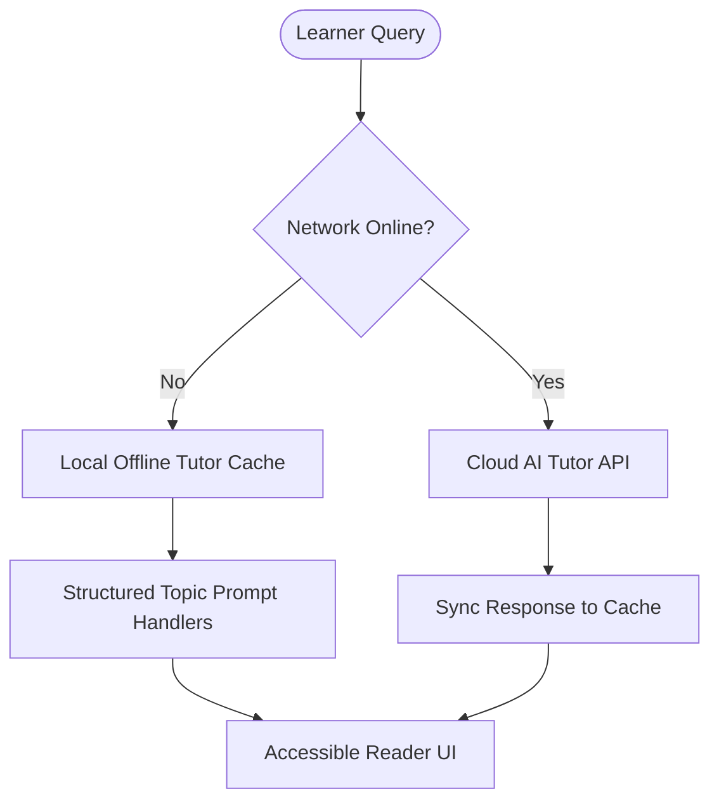

# Adaptive Neurodiverse AI Tutor

## Overview
The Adaptive Neurodiverse AI Tutor is an innovative educational tool designed to provide personalized learning experiences for neurodiverse learners. By leveraging advanced AI techniques, this tutor adapts its teaching methods to suit individual preferences and needs, ensuring an engaging and effective learning journey.

## Features

- Multi-modal teaching agent (audio, visual, structured)
- Emotion & engagement sensing (basic demo)
- Gamified peer agent (AI buddy)

## Usage

1. Install dependencies:  
   npm install

# 🌈 Adaptive AI Tutor

Empowering neurodiverse learners with personalized, agentic AI-powered education.

---

## 🚀 Features

- *Multi-Modal Lessons:* Visual, audio, video, simulation, and structured content for every learning style.
- *Agentic AI Chat:* Always-on, robust AI tutor chat with fallback and smart answers—no dead ends!
- *Gamified Peer Buddy:* Play games and take quizzes with instant feedback and scoring.
- *Progress Dashboard:* Track achievements, badges, and points with beautiful animations.
- *Accessibility First:* 10+ accessibility controls—font, color, contrast, spacing, cursor, and more.
- *Theme & Personalization:* Dark mode, high contrast, dyslexia font, and more for every user.
- *Seamless Animations:* Modern UI with smooth transitions and engaging effects.
- *No API Key Required:* Uses public/free AI endpoints and local fallback for always-available answers.

---

## ✨ Accessibility Highlights

- Change font size, family, and color themes
- Toggle line/letter spacing, bold, shadow, and outline text
- Underline links, large cursor, focus outline
- No animations mode for sensitive users
- All options apply site-wide and are keyboard accessible

---

## 🧠 Tech Stack

- *Frontend:* HTML, CSS, JavaScript
- *Backend/Logic:* TypeScript (Node.js for controllers/features)
- *AI Integration:* OpenAI, HuggingFace, public APIs, local fallback
- *Games & Simulations:* PhET, Math Playground, TurtleDiary, and more

---

## 📚 How to Use

1. *Clone the repo:*
   sh
   git clone https://github.com/Chethan13032005/Adaptive-learning.git
   cd Adaptive-learning
   
2. *Open in VS Code or your favorite editor.*
3. *Run with Live Server* (or open src/adaptive-ai-tutor/index.html in your browser).
4. *Explore:*
   - Try all features from the navigation bar
   - Adjust accessibility settings in the Accessibility page
   - Chat with the AI tutor, play games, and take quizzes

---

## 💡 Example Pages

- feature-multimodal.html — Core learning demo (AI chat, video, simulation, peer, hints)
- feature-peer.html — Peer games and quizzes
- feature-progress.html — Dashboard with achievements
- feature-accessibility.html — 10+ accessibility controls
- impact.html — Real user impact and reviews

---

## 🌟 Contributing

We welcome contributions! Please open issues or pull requests for new features, bug fixes, or accessibility improvements.

---

## 🧩 License

MIT License — Free for all learners, educators, and dreamers.

---

> "Learning is for everyone. Make it your own!"

---

## Accessibility & Keyboard Shortcuts
Adaptive Learning adheres to WCAG 2.1 Level AA compliance. Use keyboard shortcuts:

| Shortcut | Description | Target Section |
| :--- | :--- | :--- |
| `Alt + 1` | Jump to Primary Learning Feed | `#main-content` |
| `Alt + 2` | Focus Interactive AI Tutor Pane | `#tutor-chat` |
| `Alt + 3` | Jump directly to Knowledge Check Quiz | `#quiz-section` |
| `Alt + 0` | Toggle High-Contrast & Font Adjustments | `#accessibility-panel` |
| `Escape`  | Exit Active Quiz / Dismiss Modals | Active Overlay |

### Color & Display Themes
Built-in display presets cater to neurodiverse learners and vision-impaired users:
- **High Contrast Dark / Light**: Strict black & yellow/blue meeting 7:1 contrast ratios.
- **Dyslexia Enhanced**: Cream background (`#F7F3E9`) with 2.0 line-spacing and widened character tracking.
- **Calm Focus**: Muted grayscale rendering to prevent sensory overload during study sessions.

## Architecture Flow

